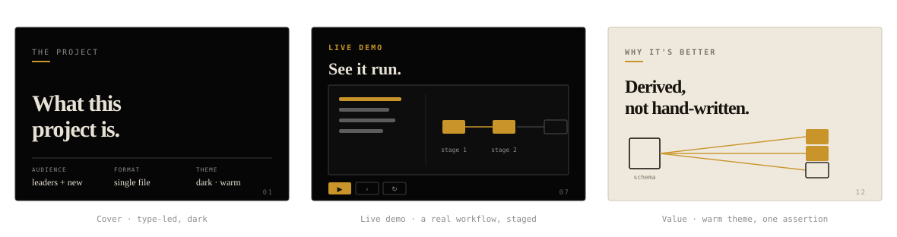
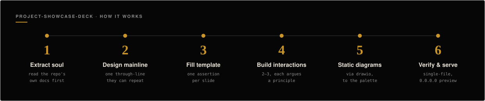

# project-showcase-deck

**Turn any code repository into a polished, single-file HTML slide deck that introduces the project to a human audience — leadership and newcomers — not a README, not docs, but a narrated showcase you can present or share.**

> 一个 Claude Code / Codex skill:把任意代码仓库变成一份**单文件 HTML 讲演稿**(暗/暖主题、可点击编辑、内置交互动画),用来给领导和新人介绍项目。

`Works in Claude Code and Codex` · `single self-contained .html` · `dark + warm theme` · `MIT`

<p align="center">
  
</p>

The output is **one `.html` file** — no build step, no external requests, no sibling assets, no server. Open it, present it, email it. Every deck carries a dark/warm theme toggle, click-to-edit mode, and 2–3 hand-built interactive demos that mimic the project's own signature workflow.

---

## Why it's not just "slides"

Almost every bad project deck fails on the same things — and none of them are CSS. This skill front-loads the parts that actually matter:

| The hard part | What the skill enforces |
|---|---|
| **Soul** | Read the repo's *own* docs (specs, ADRs, `docs/`) first — extract real positioning and differentiation, never invent. |
| **A mainline** | One through-line the audience can repeat back (`problem → what → see it → why → status`), signposted through the nav. |
| **Honesty** | Every claim is graded `shipped / partial / planned` and traceable to the repo. No fabricated metrics. |
| **The project's own words** | Vocabulary is mined verbatim from the repo's docs and identifiers — no invented umbrella terms. |
| **Assertion-evidence** | Every slide title is a full-sentence conclusion; the body is one visual that proves it — not a bullet wall. |
| **Delivery floors** | ≥2 interactions in different forms, an illustrated architecture, and true single-file integrity — mechanically checked by `verify.sh`, not left to good intentions. |

The visual system is solved once by the shipped template, so you spend your effort on the story, not the stylesheet.

---

## How it works

The skill walks the agent through six steps — from reading the repo to serving the finished page:

<p align="center">
  
</p>

1. **Extract the soul** — read the repo's own docs, then code / architecture / git / tests; write a Project Brief with a vocabulary allow-list mined verbatim.
2. **Design the mainline** — pick the through-line and nav sections; open with the pain and the answer up front, not five slides in.
3. **Fill the template** — one assertion per slide title, one visual as its evidence. Includes drawing the **cover figure**: one quiet static portrait of this project (what it makes / its shape / its real screen), derived from the Brief — the template ships a hole there, not a stock hero.
4. **Build 2–3 interactive moments** — the template ships two wired scaffolds in different forms (staged reveal + compare toggle); the agent redraws them to the real product UI, each dramatizing one design principle.
5. **Static diagrams (required)** — architecture / schema / flow via the drawio skill, styled to the palette; if the drawio toolchain isn't installed, it falls back to a hand-authored inline SVG rather than skipping the diagram. Either way the markup is inlined.
6. **Self-check and serve** — the deck is written to `showcase_deck/index.html` in the project; `scripts/verify.sh` checks single-file integrity **and the delivery floors** (≥2 interactions, diagram present, no sibling assets), then `scripts/serve.sh` auto-starts a local preview so you can view it in a browser right away.

---

## Install

The skill is a directory under your agent's personal-skills folder. Cloning it there *is* the install — and lets `git pull` keep it current.

**One-liner — Claude Code:**

```bash
git clone https://github.com/ykz9527/project-showcase-deck.git ~/.claude/skills/project-showcase-deck
```

**One-liner — Codex** (same files, different folder — see below):

```bash
git clone https://github.com/ykz9527/project-showcase-deck.git ~/.agents/skills/project-showcase-deck
```

**Or use the installer** (auto-detects Claude Code and/or Codex, installs to both, updates if already present):

```bash
git clone https://github.com/ykz9527/project-showcase-deck.git && bash project-showcase-deck/install.sh
```

**Update later:**

```bash
git -C ~/.claude/skills/project-showcase-deck pull   # or ~/.agents/skills/...
```

Then start a fresh agent session and, from inside any project you want to showcase, just ask:

> "给这个项目做一份介绍 deck"  ·  "make a showcase deck for this repo"

---

## Works in both Claude Code and Codex

The skill format is the same across both agents — a `SKILL.md` (with `name` + `description` frontmatter) plus `references/`, `assets/`, and `scripts/`. **No content changes are needed to run it in Codex** — only the install location differs:

| Agent | Personal-skills folder |
|---|---|
| **Claude Code** | `~/.claude/skills/` |
| **Codex** | `~/.agents/skills/` |

Both agents load `SKILL.md` on demand when your request matches its description, then follow the same workflow. The one soft dependency is step 5's cross-reference to a **drawio** skill for static diagrams; where that isn't available, the deck falls back to hand-authored inline SVG and the rest of the flow is unaffected.

---

## What you get

- **One self-contained `.html` file** — no external requests, no sibling assets; scroll-snap slides, auto page numbers.
- **Dark / warm editorial theme** with a toggle — no "AI slop" (no gradients, colorful badges, or emoji icons).
- **An honest, repeatable narrative** — a mainline the audience can repeat back, with graded honesty (shipped / partial / planned).
- **2–3 hand-built interactive demos** that mimic the project's real signature workflow, each arguing one design principle. Copy an interaction slide to add another — every instance is independently wired.
- **A gallery of working interactions — six machines, a dozen moves.** Organised by the machine you copy (step a sequence · select one of N states · click an element for its payload · drag a continuous parameter · traverse a graph · commit-then-reveal) and indexed by the claim each move argues, so you pick by what you need to prove. Machines compose — the guard demo is two of them stacked. Grounded in the interactive-article literature ([Distill](https://distill.pub/2020/communicating-with-interactive-articles/), [Nicky Case](https://blog.ncase.me/explorable-explanations-4-more-design-patterns/)), Bret Victor's direct manipulation, and Simon Brown's C4. A palette, not a checklist — the floor stays 2.
- **Click-to-edit mode** — reword any text, and add / remove list items, cards, and animation steps in the browser; persists to localStorage and exports to a clean standalone HTML.
- **A cover that looks like your project** — a hand-drawn portrait derived from the repo, not a stock hero. The test: swap in another project's name; if the figure still fits, it's filler.
- **A verifier that actually bites** — `verify.sh` fails a deck that ships fewer than 2 interactions, no cover figure, no architecture diagram, a duplicate `id`, a stray sibling asset, or any of the template's placeholder shapes left un-redrawn.

---

## Layout

```
SKILL.md                     # entry point: DNA, non-negotiables, workflow, red flags
install.sh                   # one-command installer (Claude Code + Codex)
references/
  extract-the-soul.md        # what to mine from the repo + honesty grading + vocabulary fidelity
  narrative-spine.md         # choosing the mainline + nav signposting (SCQA opening)
  content-logic.md           # per-slide logic: SCQA, assertion-evidence, Rule of One, C4, trade-offs
  visual-system.md           # editorial design language, anti-"AI slop", palette/fonts
  deck-mechanics.md          # single-file structure, themes, edit mode, animations
assets/
  deck-template.html         # the proven skeleton to copy (dark/warm, edit mode,
                             #   2 interaction scaffolds, inline architecture figure)
  interaction-patterns.html  # browsable gallery of 8 working interaction forms —
                             #   a palette to copy from, not a checklist to fill
  img/                       # README figures
scripts/
  verify.sh                  # structure + single-file integrity + delivery floors
  serve.sh                   # serve a deck on 0.0.0.0 for browser viewing
```

## Requirements

- **Claude Code** or **Codex**.
- Static diagrams use the **drawio** skill (optional; needs the drawio CLI or an extracted AppImage + `xvfb` for headless SVG export). Without it, the deck hand-authors inline SVG.

## License

MIT — see [LICENSE](LICENSE).
